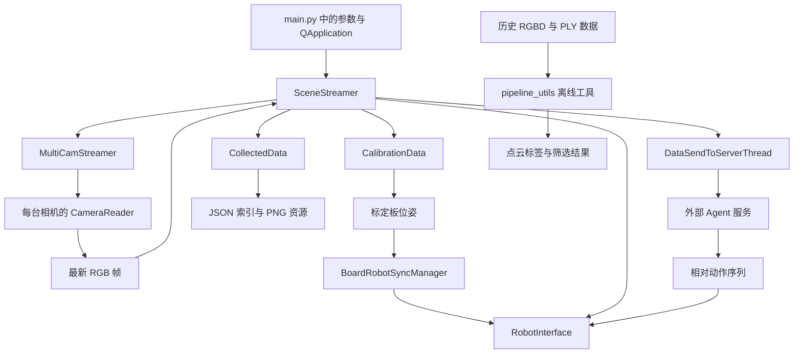

# 系统架构与运行边界

PointCloudStream 的主要任务是将视觉观测、机械臂状态和人工示教过程关联起来，形成可回放、可保存、可供外部模型处理的数据。系统的复杂性集中在设备访问时序、空间变换约定和跨线程状态传递，而不是普通界面控件。

## 模块组织

图中主窗口路径表示源码中的调用关系，部分分支仍保留旧接口，见“入口与兼容性边界”。离线点云工具消费历史数据，并非由当前主窗口自动生成输入。

| 层次 | 核心实现 | 职责 |
| --- | --- | --- |
| 入口与协调 | [main.py](../main.py)、[app/entry.py](../app/entry.py) | 构造参数、持有运行状态、刷新观测、绑定业务回调 |
| 界面 | [app/ui/app_ui.py](../app/ui/app_ui.py) | 多相机网格、控制面板与状态曲线 |
| 采集 | [scene_viewer.py](../app/viewers/scene_viewer.py)、[cam_reader.py](../app/threads/cam_reader.py) | 设备接入、独立读取线程、最新帧缓存 |
| 标定与几何 | [calibration_data.py](../app/utils/calibration/calibration_data.py)、[robot/pose.py](../app/utils/robot/pose.py) | 相机内参、标定板姿态、刚体变换 |
| 机械臂控制 | [robot_utils.py](../app/utils/robot/robot_utils.py)、[board_sync.py](../app/utils/robot/board_sync.py) | SDK 适配、逆运动学、异步跟随 |
| 示教数据 | [data_callbacks.py](../app/callbacks/data_callbacks.py)、[collect_data.py](../app/utils/data_management/collect_data.py) | 关键点记录、回放录制与持久化 |
| 网络 | [op_thread.py](../app/threads/op_thread.py)、[network_server.py](../app/utils/networking/network_server.py) | 请求响应传输与外部处理函数接入 |
| 离线工具 | [pipeline_utils](../pipeline_utils) | 点云分割、人工检查、数据集转换 |

`SceneStreamer` 同时持有设备、数据模型、线程对象和界面状态。业务回调通过 `self` 访问这些对象，模块之间没有独立消息总线或统一的任务调度器。

## 初始化与运行流程

### 入口定义的初始化顺序

`main()` 直接创建参数字典，然后创建 `QApplication` 和 `SceneStreamer`。窗口构造先建立界面，再创建 `MultiCamStreamer`、`USBVideoManager`、`QTimer`、`CollectedData` 和 `ConversationData`。

设备枚举与数据目录创建发生在窗口构造阶段。相机读取、机器人连接和标定初始化由相应按钮回调触发。`load_in_startup` 虽然出现在入口参数中，但没有对应的启动执行逻辑。

### 一次界面刷新

`SceneStreamer.frame_calling()` 的顺序为：

1. 按每十次回调的时间间隔更新显示 FPS。
2. 从各 `CameraReader` 取出尚未消费的最新帧。
3. 如果机械臂对象存在，读取选定类型的状态，再单独读取 TCP 位姿。
4. 将名称恰好为 `control` 的图像逆时针旋转 90 度。
5. 更新图像和曲线，在符合名称条件的相机图像上检测标定板。
6. 将本轮结果写入 `current_frame`，必要时请求异步跟随。

`current_frame` 是一个混合字典：相机名称对应 RGB 数组或 `None`，其他键保存 FPS、机器人位姿、曲线数据以及可选的标定板位姿。它不是带统一时间戳的传感器快照。

### 示教与回放

手工采集保存任务文本对应的 TCP 位姿、关节位置和图像。回放以关节位置为输入，先插值为目标点列，再通过 `RobotJointOpThread` 执行。独立 Python 线程在运动期间读取机器人状态和 `current_frame`，形成连续录制数据。

关键点、回放指令和实际观测是三个层次：插值点决定下发目标，采样记录描述读取到的机器人状态，相机图像来自最近一次界面刷新。它们没有一一对应的硬件同步关系。

## 线程与共享状态

| 执行位置 | 工作 | 与其他线程共享的数据 |
| --- | --- | --- |
| Qt 主线程 | 控件操作、定时刷新、标定板检测、部分 SDK 状态读取、JSON 保存 | `current_frame`、数据模型、机器人对象 |
| 每相机一个 `CameraReader` | 读取设备、BGR 转 RGB | 受 `QMutex` 保护的单帧缓存 |
| HTTP 相机内部 `MJPEGStreamReader` | 网络分块读取、JPEG 解码 | 另一份受锁保护的单帧缓存 |
| `RobotTcpOpThread` / `RobotJointOpThread` | 阻塞式机器人动作序列 | 同一个 `RobotInterface` 与录制标志 |
| 跟随 `StepWorker` | 计算目标位姿并等待机械臂运动结束 | 同步原点和机器人对象 |
| 回放采样 Python 线程 | 周期读取状态、组织录制条目 | `current_frame`、任务文本、`CollectedData` |
| 每次记录创建的写图线程 | 保存该条记录的多路 PNG | 图像数组与资源路径 |
| `DataSendToServerThread` | 网络请求、响应反序列化 | 请求字典与返回结果 |

只有相机缓存明确使用了互斥锁。`CollectedData` 虽然创建了 `lock`，记录增删与保存没有使用它。多个动作入口也没有共享的运动互斥机制：跟随模块的 `is_moving` 只约束跟随模块内部。

因此，“设备读取在后台线程”不意味着整个程序不会阻塞。PnP 检测和状态查询仍在界面刷新路径中，服务扫描直接等待发现超时，录制结束回调还会同步等待采样线程退出。

线程表描述明确的定时器、工作线程和设备任务。录制与网络信号大量通过 lambda 或 `partial` 转发到普通函数，没有统一绑定为主窗口的 `@Slot` 或显式指定队列连接，不能仅凭使用了 Qt 信号就认定所有回调都在界面线程执行。回调中访问控件的线程归属仍是接口约束。[Qt for Python 线程归属说明](https://doc.qt.io/qtforpython-6/tutorials/basictutorial/signals_and_slots.html#thread-affinity)

## 配置的实际来源

运行 `main.py` 时，以函数内部的 `params` 为入口配置；窗口中的相机列表和标定控件会进一步修改部分参数。[config.json](../config.json)没有被主入口读取。

| 参数或文件 | 当前用途 |
| --- | --- |
| `camera_list` | 相机设备编号、逻辑名称和 HTTP 地址；启动采集前由界面重建 |
| `board_shape`、尺寸和字典 | 构造 ChArUco 棋盘；尺寸从毫米换算为米 |
| `folder_path` | 主窗口标定样本保存目录 |
| `calib_path` | 初始化标定路径控件，标定检查回调也从此参数读取文件 |
| `data_path` | 构造 `CollectedData` 时确定初始索引目录与资源目录 |
| `service_type`、`discovery_timeout` | Zeroconf 扫描 |
| `use_fake_camera` | 主入口中保留，但相机类型实际由设备编号选择 |
| `load_in_startup` | 未接入自动初始化 |
| `device`、`yolo_model_path`、`camera_config`、`rgbd_video` | 没有进入当前主窗口采集链的执行路径 |

`CameraReader` 的模拟设备选择条件是 `id == -1`。仅将 `use_fake_camera` 设为 `True` 不会将 USB 相机列表替换成模拟相机。

## 入口与兼容性边界

### 包导出与依赖加载

[app/utils/robot/__init__.py](../app/utils/robot/__init__.py)从 `robot_utils.py` 导出 `RobotInterface`，[app/utils/__init__.py](../app/utils/__init__.py)再集中导出机器人、相机、标定与数据模型。导入这一个公共包会加载多个子模块及其外部依赖，功能在界面中尚未启用也不会延迟对应导入。

### 当前主链与保留代码

- 主窗口的 `SceneViewer` 是图像网格与 pyqtgraph 曲线，没有创建 VTK 点云渲染器。旧包围盒、三维坐标轴回调引用的渲染对象不在当前窗口初始化流程中。
- `CalibrationData` 当前提供相机内参与 PnP，旧工作流仍调用不存在的 `calibrate_hand_eye()`；相关按钮的存在不代表手眼标定流程完整。
- 主程序导入的 `robot.pose.Pose` 没有 `from_matrix()`，旧标定选择回调却调用该方法。
- 当前采集写入动态的 `<camera_name>_cam_files`；加载器和离线工具仍分别依赖固定双相机格式或旧 RGBD 格式。
- `vtk_tracker.py` 和 `joycon_control.py` 引用仓库中不存在的 `remote_control` 模块，并使用旧控制接口，属于需要适配的独立实验入口。

这些边界分别影响功能调用、坐标解释、数据互操作和历史工具使用，不应通过按钮名称或旧 README 描述推断其可用性。

## 运行依赖与平台边界

核心桌面路径依赖 NumPy、SciPy、PySide6、OpenCV、Pillow、requests、zeroconf、pyqtgraph 和 Lebai SDK。包初始化存在交叉导入，不能按“尚未点击机器人按钮”推断 Lebai SDK 为可选依赖。包级回调和位姿工具还会导入 VTK。

点云工具另外使用 Open3D、PyTorch、Ultralytics、plyfile、scikit-learn 和 tqdm；Notebook 涉及 pandas 以及模型训练相关依赖。板卡 PDF 生成器使用 reportlab。

USB 枚举依赖 Linux 的 `v4l2-ctl` 与 `/dev/videoN` 命名。模拟相机和 HTTP 相机有独立的接入方式，但不会消除其他包的导入要求。代码使用 `match` 等 Python 3.10 之后的语法，原 README 的环境示例采用 Python 3.11；仓库没有依赖锁文件。

多个入口包含特定机器的数据路径、模型路径和相机编号。离线脚本还可能在模块顶层加载模型、读取数据或写入资源，不能将导入这些脚本视为无副作用的接口探测。
