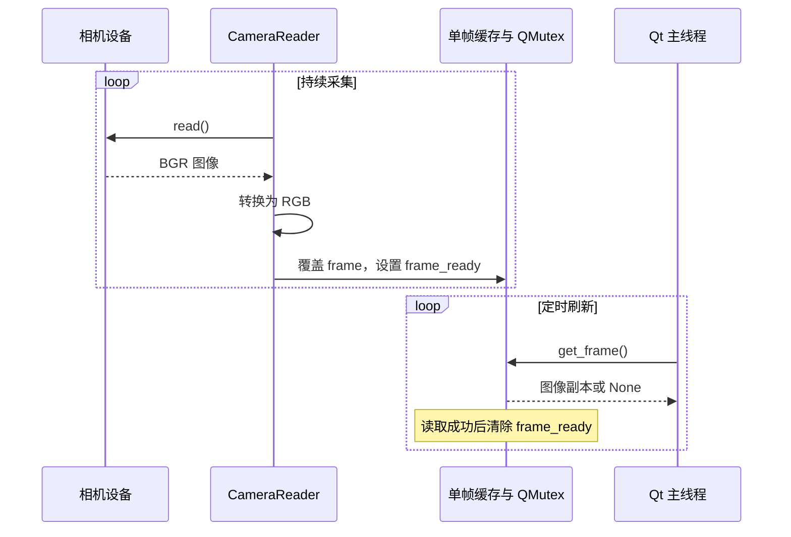

# 多相机采集与实时显示

多台相机具有不同的读取速度和阻塞特性。采集模块通过独立读取线程与单帧缓存，让界面按自己的刷新节奏获取最新可用图像，避免在界面线程中逐台等待相机读取。

这一设计优先保证预览的新鲜度，不保留完整帧序列，也不提供多相机曝光同步。录制时序的含义需要结合这一点理解。

## 核心实现

| 实现 | 关键职责 |
| --- | --- |
| [MultiCamStreamer](../app/viewers/scene_viewer.py) | 根据配置创建相机、管理相机线程、汇总帧字典 |
| [CameraReader](../app/threads/cam_reader.py) | 循环读取、颜色转换、互斥访问和消费标记 |
| [MJPEGStreamReader 与 HTTPCamera](../app/utils/camera/device/http_camera.py) | HTTP 字节流解析、JPEG 解码与设备适配 |
| [FakeCamera](../app/utils/camera/device/fake_camera.py) | 生成模拟图像与可选模拟深度 |
| [USBVideoManager](../app/utils/camera/device/usb_camera_parser.py) | Linux 视频设备枚举 |
| [SceneStreamer.frame_calling](../app/entry.py) | 汇总图像与机器人状态，驱动界面和标定检测 |

## 设备适配约定

`MultiCamStreamer.init_by_cam_id()` 按编号选择实现：

| 条件 | 对应实现 | 读取结果 |
| --- | --- | --- |
| `id == -1` | `FakeCamera` | 默认返回模拟 BGR 彩色图像 |
| `id == 99` 且具有 `http_url` | `HTTPCamera` | 返回内部缓存的 BGR 图像 |
| 其他情况 | `cv2.VideoCapture(id)` | 返回设备读取结果 |

统一的最小接口是 `read() -> (success, frame)` 和 `release()`。`CameraReader` 将三通道 BGR 图像转换为 RGB，后续主窗口与 PNG 保存路径按 RGB 使用。

HTTP 相机构造时即启动网络线程，构造成功只表示线程对象已建立，不表示 HTTP 请求成功或已经收到有效图像。编号 `99` 缺少 URL 时会落入 `VideoCapture(99)` 分支。

`FakeCamera` 的默认图像为 640×480，包含横向移动的圆形。深度由约 1000 毫米的基准值叠加正弦变化，并加入随机缺失区域。只有 `read(both=True)` 或 `capture_frame()` 返回 `FakeRGBDFrame`；当前 `CameraReader` 调用不带参数的 `read()`，因此主窗口仍只收到彩色图像。

## 最新帧缓存



读取线程在每轮结束后休眠 5 毫秒。缓存只包含一张图像：生产者在消费者读取之前写入多次时，旧图像直接被覆盖。`get_frame()` 在锁内复制数组，然后将 `frame_ready` 置为 `False`。

这形成了有界缓存：内存不会因界面变慢而积累整段视频，代价是跳过中间帧。对于分辨率为 `W×H` 的三通道 `uint8` 图像，单份像素缓冲约为 `3WH` 字节；读取副本、Qt 图像和 HTTP 内部缓存会增加同时驻留的图像份数。

设备读取失败时，线程清除就绪标志，不把上一张图像重新标记为有效。汇总结果仍保留该相机名称，但值为 `None`。界面更新函数遇到 `None` 会直接返回，因此窗口可能继续显示上一张图像；“画面仍可见”不代表本轮收到新帧。

## HTTP MJPEG 的两级缓存

HTTP 路径为：

```text
HTTP 字节流
  → MJPEGStreamReader 的 BGR 缓存
  → HTTPCamera.read()
  → CameraReader 的 RGB 缓存
  → 主窗口刷新
```

`MJPEGStreamReader` 使用 `requests.get(..., stream=True, timeout=5)`，每次从响应中取得最多 1024 字节，追加到 `bytes_buffer`。解析器搜索 JPEG 开始标记 `FF D8` 和结束标记 `FF D9`，取出完整片段后调用 `cv2.imdecode()`，再移除已处理字节。

该实现依据 JPEG 标记恢复图像，没有解析 multipart boundary 或每帧的 `Content-Length`。每次网络分块循环最多解码一张 JPEG，然后休眠 10 毫秒；若缓冲中已有多张完整图像，其余图像要等待后续循环处理。

内部 `read()` 只检查是否曾经取得图像，不使用帧序号或消费标记。外层 `CameraReader` 因而可能反复读取同一张 HTTP 图像，并把每次读取都视为成功。网络线程退出后，已缓存的图像也不会自动清空。

HTTP 适配层没有自动重连、帧龄检查或字节缓冲上限。断流、重复图像和坏数据不能仅凭外层读取成功区分。

## 相机名称是业务接口

相机名称同时用于线程字典、界面控件、帧字典和数据文件名，因此需要唯一。界面新增相机时会为重复名称追加后缀，`MultiCamStreamer.add_camera()` 本身没有对应的重复键保护。

`control` 还承担特殊业务语义：

| 条件 | 行为 |
| --- | --- |
| 名称包含 `control` | 创建相机时尝试设置 MJPG、1920×1080、30 FPS |
| 名称恰好等于 `control` | 主窗口将图像逆时针旋转 90 度 |
| 名称包含 `control` | 界面更新时尝试执行标定板检测 |
| 名称恰好等于 `control` | 标定采集回调从该键读取图像 |

例如 `control_1` 会触发设备参数设置和检测，但不会进入精确名称对应的旋转与标定采集分支。多个包含该字符串的相机产生的位姿，也会写入同一个 `board_pose` 键。

`FakeCamera` 和 `HTTPCamera` 均未实现 `set()`。给它们使用包含 `control` 的名称，会触发设备参数设置接口不匹配。相机名称也应避开 `fps`、`robot_pose` 等主窗口元数据键，当前系统没有独立命名空间来隔离这些键。

## 时间与颜色约定

主窗口计时器间隔为 30 毫秒，理论触发频率约为 33.3 次每秒。实际刷新耗时还包括 SDK 状态读取、图像转换、标定板检测和绘图；界面 FPS 统计的是回调执行频率，不是设备曝光帧率。

各相机按顺序读取缓存，既没有共同时钟，也没有时间戳配对。机器人曲线状态与 TCP 位姿还来自独立的 SDK 查询。因此，一轮 `current_frame` 只代表一次软件层汇总。

实时图像进入主窗口时已经是 RGB，`CalibrationData.board_dectect()` 却使用 `COLOR_BGR2GRAY`。对黑白标定板影响通常小于对彩色图像的影响，但颜色约定并不一致。PNG 写入使用 `PIL.Image.fromarray()`，与 RGB 约定一致。

相机旋转发生在标定和录制之前。标定内参必须对应旋转后的图像分辨率、像素坐标和光学配置；显示控件中的等比缩放只是预览，不会改变保存的原始数组。

## 机器人状态曲线的环形缓存

[RobotPoseGraphWidget](../app/ui/robot_graph_widget.py)为六个通道各预分配 300 个数值位置。每次刷新把新状态写入 `data_index`，索引按 300 取模；绘制时用 `np.roll(..., -data_index)` 将缓冲重排为从旧到新的顺序。这样曲线历史长度固定，不随程序运行时间增长。

TCP 模式显示位置和欧拉角，关节模式显示六个关节角。切换状态类型会清空缓冲，初始未填满部分为零。横轴虽然标为 Time，实际传给图形库的是样本序列，没有采集时间戳；TCP 模式还把米和弧度画在同一个纵轴上。该图适合观察变化趋势，不能直接作为精确时间或统一物理量的测量图。

## 生命周期与停止语义

启动按钮先重建相机网格，再连接设备。任一相机初始化返回失败时，会调用 `disconnect()` 停止已建线程并释放设备。成功后将计时器连接到 `frame_calling()` 并开始刷新。

正常停止路径是：停止界面计时器 → 等待所有读取线程结束 → 释放设备 → 清空相机与线程字典。`CameraReader.stop()` 使用无超时的 `wait()`；如果底层设备读取持续阻塞，停止过程也可能被阻塞。

HTTP 内部停止会设置事件、关闭响应，并等待 150 毫秒；未退出时调用 `terminate()`。外层相机线程的停止与这一内部网络线程的停止是两个阶段。

当前生命周期还有两个直接影响行为的边界：

- 每次重新启动都会再次连接 `timer.timeout`，停止时没有断开原连接，重复启动可导致一次超时触发多次刷新。
- 窗口关闭回调停止计时器并清空部分引用，但没有显式调用 `streamer.disconnect()`，也没有统一等待机械臂与网络工作线程结束。

以上限制关系到关闭行为和重复连接，不改变单帧缓存本身的线程互斥语义。
