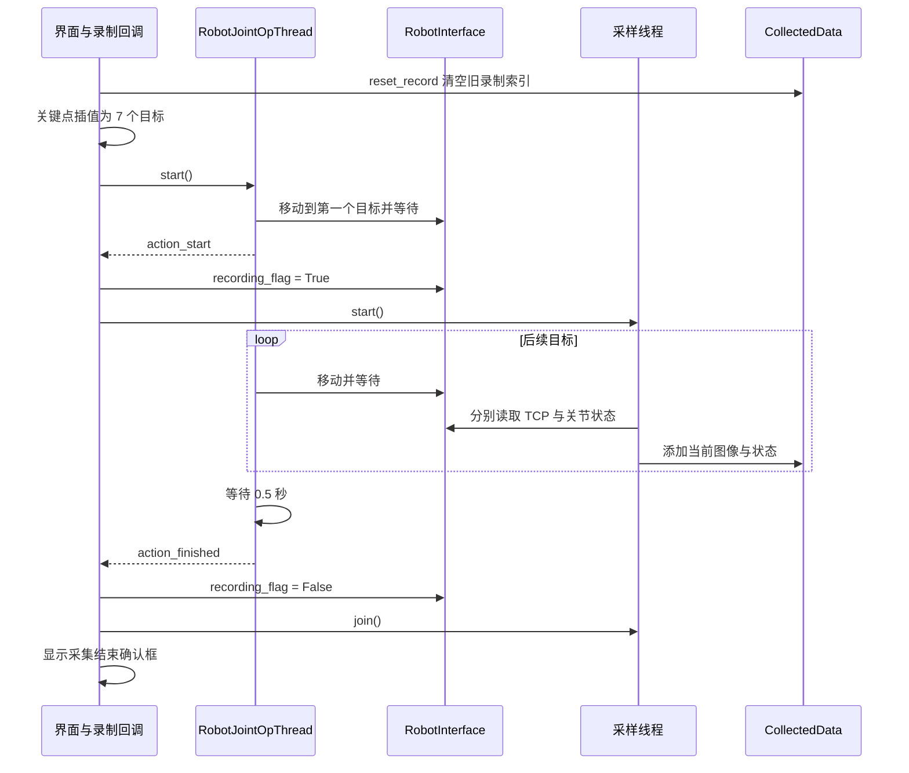

# 示教数据采集与持久化

数据采集模块把任务文本、人工关键点、回放中的机器人状态以及多相机图像组织成 Episode。它解决的是“同一任务的指令、运动和观测如何关联”的问题，核心在于两个采集阶段的区分、录制线程的启动时机，以及索引与资源的一致性。

## 核心实现

| 文件 | 主要职责 |
| --- | --- |
| [collect_data.py](../app/utils/data_management/collect_data.py) | `CollectedData`；Episode 管理、图像保存、JSON 序列化 |
| [data_callbacks.py](../app/callbacks/data_callbacks.py) | 手工采集、回放准备、采样循环、录制结束处理 |
| [op_thread.py](../app/threads/op_thread.py) | 关节执行线程与录制握手信号 |
| [pose_interpolate.py](../app/utils/pose/pose_interpolate.py) | 稀疏关节关键点重采样 |

## Episode 的身份与两阶段模型

`CollectedData` 使用平行列表 `dataids` 与 `episode_list` 保存身份和内容，新记录以 `uuid.uuid4().hex` 生成 ID。但是否新建 Episode 由任务文本决定：只要 `prompt` 已经存在，就向首个同名 Episode 追加。

因此，同一文本的多次独立演示会被合并，而不是自然形成多个 Episode。UUID 是持久化身份，`prompt` 同时承担当前内存模型的分组键。

| 字段 | 含义 | 产生阶段 |
| --- | --- | --- |
| `prompt` | 任务文本 | 创建 Episode |
| `pose` | 手工采集的 TCP 关键点，六维，米与弧度 | `record_stage=False` |
| `joint_positions` | 对应的关节关键点，六个弧度值 | `record_stage=False` |
| `pose_record` | 回放期间读取到的 TCP 状态 | `record_stage=True` |
| `joint_position_records` | 回放期间读取到的关节状态 | `record_stage=True` |
| `<camera_name>_cam_files` | 按录制索引排列的图像文件名 | `record_stage=True` |

人工关键点决定回放路径，连续记录描述回放过程中采样到的状态。两组数组长度通常不同，不能互相代替。

## 手工采集

`on_data_collect_button_clicked()` 单独读取 TCP 位姿与关节位置，再从 `current_frame` 取出已配置相机的图像，以 `record_stage=False` 调用 `add_record()`。

`add_record()` 会将 NumPy 状态数组转成列表，并把关节角换算为角度进行范围检查。任一角度超出 `[-360, 360]` 时拒绝本条记录；这个判断没有描述机器人各关节的真实限位，也不是动作执行前的限制。

关键点采集会写入 PNG，但文件名不会追加到 `<camera_name>_cam_files`。因此，关键点图像可能存在于资源目录，却不被 JSON 图像列表引用。

对于第一次出现的 `prompt`，代码总是把输入状态写入关键点列表，即便调用时 `record_stage=True`。正常回放依赖此前已经创建 Episode；从连续录制直接创建 Episode，会使首条状态落入不同阶段。

## 回放和录制的完整时序



图中的“界面与录制回调”是逻辑参与者，不是单一线程保证。开始与结束信号经 lambda 转发到普通函数，代码没有统一使用主窗口队列槽；线程归属约束见[系统架构](architecture.md)。

回放前先调用 `reset_record()`，再尝试二次插值。若插值失败，旧的录制列表已经被清空。插值使用关节空间累计距离参数，原理和输入条件见[位姿表示与轨迹插值](pose-and-interpolation.md)。

运动线程到达第一个目标后才发出录制开始信号，并等待录制标志。该握手避免后续目标在采样线程启动之前全部执行，但没有等待“第一组有效图像与状态已落盘”。

界面中的“Replay and Save”回调只重放并采样，不调用 `CollectedData.save()`。JSON 持久化由独立的 Save Data 操作触发。采集结束对话框的确认或取消只产生不同日志，不提交或回滚数据。

## 采样频率与时间关联

采样循环目标频率为 15 FPS，每轮完成以下动作后再休眠 `1/15` 秒：读取 TCP、读取关节、收集帧引用、追加记录、发出数据变化信号。

```text
实际采样周期 = 状态读取耗时 + 组织记录耗时 + 1/15 秒
```

它没有用绝对时钟补偿本轮工作耗时，所以实际采样频率通常低于目标值，并受到 SDK 延迟影响。累积 301 次进入记录分支后，`idx > 300` 的保护条件使采样线程退出；该退出本身不会停止运动线程或清除录制标志。

多相机完整性判断只检查 `current_frame` 是否包含每个相机键，不检查对应图像是否为 `None`。帧字典由主线程更新，采样线程又逐项读取，途中没有冻结统一快照。机器人状态与各相机图像也没有时间戳和帧序号。

文件名中的同一个录制索引表示“同一次软件采样调用所关联的条目”，不能解释为多台相机同一曝光时刻。相机线程的单帧缓存行为见[多相机采集与实时显示](camera-streaming.md)。

## 图像资源与异步写入

资源目录在构造时确定为 `<data_path>/resources`。图像命名规则为：

```text
<episode_id>_<camera_name>_<index>.png
```

关键点阶段的索引来自关键点数量，录制阶段的索引来自 `pose_record` 数量。两者共用文件命名空间，所以同一 Episode、同一相机的录制图像可能覆盖此前的关键点图像。

每次 `add_record()` 都为本条记录新建一个 Python 写图线程。该线程按相机顺序使用 `Image.fromarray(frame).save()` 保存非空图像，主线程或采样线程不会等待其结束。

图像文件名先进入记录，实际写入随后发生。这种解耦减少了采样路径上的磁盘等待，但有以下含义：

- `save()` 写完 JSON 时，部分 PNG 可能仍未完成。
- 图像为 `None` 时不写文件，但相应文件名仍可能已经追加。
- 写图异常没有回传为 Episode 的失败状态。
- 没有有界写入队列或背压；磁盘持续落后时，线程数和待保存图像引用可能增长。
- 写图线程没有与删除、重置或路径切换协调，索引操作和资源操作不构成事务。

## JSON 格式

`save()` 生成 `shown_data.json` 和 `saved_data.json`。

`shown_data.json` 是面向数据树的精简视图：省略大部分连续状态与相机文件列表，加入 `record_len`，并按 Episode 的逆序输出。`record_len` 取 `joint_position_records` 的长度，不统计成功写入的图片数量。

`saved_data.json` 保留 Episode 内容，同时从关键点 `pose` 生成额外的邻接对 `poses`：

```text
poses[i].pose0 = pose[i]
poses[i].pose1 = pose[i+1]，最后一项为 null
```

以下结构展示一个具有两个关键点和一条录制数据的记录，数值仅用于说明字段：

```json
{
  "example_episode": {
    "prompt": "移动到目标位置",
    "pose": [
      [0.2, 0.0, 0.4, 0.0, 0.0, 0.0],
      [0.3, 0.0, 0.4, 0.0, 0.0, 0.0]
    ],
    "joint_positions": [
      [0.0, 0.1, 0.2, 0.3, 0.4, 0.5],
      [0.1, 0.2, 0.3, 0.4, 0.5, 0.6]
    ],
    "pose_record": [[0.2, 0.0, 0.4, 0.0, 0.0, 0.0]],
    "joint_position_records": [[0.0, 0.1, 0.2, 0.3, 0.4, 0.5]],
    "poses": [
      {
        "pose0": [0.2, 0.0, 0.4, 0.0, 0.0, 0.0],
        "pose1": [0.3, 0.0, 0.4, 0.0, 0.0, 0.0]
      },
      {
        "pose0": [0.3, 0.0, 0.4, 0.0, 0.0, 0.0],
        "pose1": null
      }
    ],
    "main_cam_files": ["example_episode_main_0.png"],
    "control_cam_files": ["example_episode_control_0.png"]
  }
}
```

`poses` 来自人工关键点，不是从 `pose_record` 生成的连续动作监督。图像列表却主要来自回放录制，因此不能直接按同一下标把 `poses[i]` 和录制图像配成训练样本。

## 路径切换与加载兼容性

`CollectedData.path` 的 setter 只更新 JSON 目录，不更新 `resource_path`。调用 `save(new_path)` 或 `load(new_path)` 后，JSON 与资源可能位于不同根目录：

```text
初始路径/resources/         ← PNG 仍写入或从此处检查
新路径/saved_data.json      ← JSON 写入或读取位置
```

这种布局在当前实现中是可发生的，但 JSON 没有记录资源根目录。迁移数据时仅复制新路径不能保证携带完整图像。

保存器按实际相机名输出任意 `<name>_cam_files`，加载器却固定读取 `main_cam_files` 与 `wrist_cam_files`，并只恢复这两路图像列表。默认入口相机是 `main` 和 `control`，保存结果与加载器要求并不一致。

加载器根据 `poses[*].pose0` 恢复关键点 `pose`，并检查固定两路相机的所有文件是否存在。缺少键会报错，文件缺失则跳过整个 Episode。`camera_names` 没有在加载时按记录重建。

## 删除、重置与并发一致性

`pop()` 删除 Episode 及其中列出的相机文件，不会自动更新已经保存到磁盘的 JSON。未被列表引用的关键点图像不在这一清理范围内。

`pop_pose()` 只删除关键点 TCP 和关节位置；关键点全部删除时移除 Episode，但不会同步清理其所有录制资源。`reset_record()` 清空连续状态与相机文件列表，也不会删除旧文件。下一次较短录制可能覆盖部分旧文件并留下其余资源。

采样线程会修改 `episode_list`，UI 回调又可能在同一时间展示、保存或删除记录。虽然类中创建了锁对象，但相关方法没有使用它；采样线程还直接读取界面任务文本。因此录制期间修改文本、切换 Episode 或执行保存，可能改变数据归属或得到不一致的索引。

## 数据使用所需的不变量

完整的录制数据应满足以下关系；当前保存器不会自动校验全部条件：

1. `pose` 与 `joint_positions` 的长度一致，每项都是六维且单位明确。
2. `pose_record`、`joint_position_records` 及参与该次录制的各相机文件列表具有一致的采样索引。
3. 每个图像引用都能在确定的资源根目录下解析，并对应已完成写入的文件。
4. 图像索引与关键点索引采用不同含义，训练集转换必须显式选择监督来源。
5. 同一 Episode 的任务文本与相机集合在录制期间保持明确的归属关系。

这些不变量用于定义数据格式的语义。当前文件存在或 JSON 可解析，只能说明存储结构有效，不能替代时间关联与样本完整性判断。
