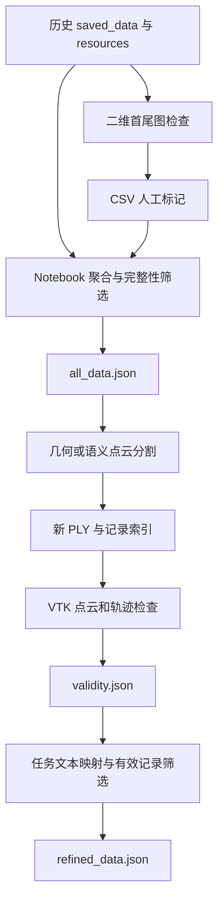

# 离线数据整理与三维检查

离线工具负责把历史采集结果转换为可检查、可筛选、可重标注的数据集。主要技术环节包括资源与记录的关联、点云批处理、三维可视化、人工有效性标记，以及图像掩码到模型训练格式的转换。

这部分包含独立 Python 脚本和交互式 Notebook，各段具有自己的数据假设与路径。它们不是由桌面主程序统一调度的一条自动流水线。

## 实现范围

| 实现 | 作用 |
| --- | --- |
| [data_viewer_2d.py](../pipeline_utils/data_viewer_2d.py) | 按任务显示首尾彩色图，保存人工有效性标记 |
| [data_viewer_utils.py](../pipeline_utils/data_viewer_utils.py) | `SceneViewerVTK`；点云、轨迹与目标位置的三维检查 |
| [cluster_seg_pcd.py](../pipeline_utils/cluster_seg_pcd.py) | 多进程几何分割与 PLY 保存 |
| [seg_from _2d_or_map_color.py](<../pipeline_utils/seg_from _2d_or_map_color.py>) | 二维语义向点云映射及可选 RGBD 重建 |
| [data_processing.ipynb](../pipeline_utils/data_processing.ipynb) | 资源清理、记录聚合、标签转换、训练与最终筛选 |
| [vtk_tracker.py](../app/utils/vtk_tracker.py) | 独立的标定板与虚拟机器人三维显示原型 |

## 三种数据接口

项目中同名的 `saved_data.json` 并不保证具有相同字段。

| 数据接口 | 图像与空间数据字段 | 当前消费者 |
| --- | --- | --- |
| 当前多相机保存格式 | 动态 `<camera_name>_cam_files`、关键点和连续机器人状态 | `CollectedData.save()` 输出 |
| 固定双相机格式 | `main_cam_files`、`wrist_cam_files` | `CollectedData.load()` |
| 历史 RGBD 与点云格式 | `color_files`、`depth_files`、`point_cloud_files`、`pose` 等 | 大部分 `pipeline_utils` 与 Notebook |

当前主窗口既不生成深度列表，也不生成 `point_cloud_files`。历史工具不能通过更换目录就直接消费新的多相机输出，需要显式确定输入格式和资源映射。

旧工具通常以 JSON 的记录 ID 关联任务文本与资源列表，并通过列表下标对应同一条记录中的图像和点云。数据中没有统一的格式版本字段，跨工具使用时必须按字段和语义识别。

## 数据加工关系



各箭头表示工具间的数据关系，不代表现有脚本自动完成格式转换、资源搬迁或阶段调度。尤其是点云输出目录与 JSON 中的文件名引用，需要保持一致。

## 二维人工检查

`data_viewer_2d.py` 扫描数据根目录的子文件夹，在其中读取以 `saved_data.json` 结尾的文件。图像资源则统一从数据根目录的 `resources` 读取，不是从每个子文件夹读取。

检查对象以 `(folder, uuid)` 作为标记键，显示 `color_files` 的第一张和最后一张。首尾图适合比较任务前后的明显变化，但不会检查中间帧的运动连续性、丢帧或状态对齐。

界面在缩放图上绘制中央正方形作为观察辅助，既不裁剪资源，也不生成训练标签。默认未标记记录在“有效记录”导航中被当作可用记录，因为判断条件只是标记不等于 `Invalid`。

标记保存为 CSV：

```csv
folder_name,uuid,mark
session_a,example_episode,Invalid
```

当前加载按钮读取的也是 CSV。仓库根目录中的 `marks.json` 具有进度和标记列表结构，但没有接入当前二维检查器的读写流程。

## VTK 点云渲染与轨迹检查

### 从 PLY 到可渲染对象

`SceneViewerVTK.load_point_cloud()` 直接按文本读取 PLY，查找 `end_header` 后，每八行取一行，再按固定列顺序解析坐标、颜色和标签。它没有使用通用 PLY 属性解析器，因此要求兼容的 ASCII 顶点布局，不适用于任意二进制 PLY 或属性重排。

```text
ASCII 顶点行
  → NumPy 坐标、颜色、标签
  → vtkPoints 与两套颜色数组
  → vtkPolyData
  → vtkVertexGlyphFilter 生成顶点单元
  → vtkPolyDataMapper
  → vtkActor
```

原始颜色与分割颜色作为两套 point data 数组保存，切换显示时由 mapper 选择数组。分割颜色通过标签作为随机种子生成，因此同一标签产生相同颜色。若标签为 `-1`，直接调用 `np.random.seed(-1)` 会失败，与语义分割正常使用的无标签值不兼容。

每八行抽样降低显示点数，但不是体素下采样。其空间覆盖受原始文件排序影响，细小区域和局部结构可能被跳过。每次切换场景或显示状态会重新加载并构造渲染对象，没有跨场景点云缓存。

### 轨迹与目标中心

查看器把 `pose` 中相邻位置连接成线，并在最后一个位姿绘制坐标轴。它还按 `segment_id` 分组，计算各组平均 RGB，选择最接近固定参考色 `[213, 144, 106]` 的组，以该组点坐标的平均值作为中心。

此中心是经过文件抽样后、由颜色启发式选择的点集质心，不是语义模型直接输出的目标中心，也不是球面拟合结果。中心球体只是显示标记。

程序显示末端最后位置到该中心的欧氏距离。距离具有物理意义的前提是 `pose` 与点云使用相同坐标系和长度单位；查看器没有自动应用手眼外参。坐标轴按 VTK 的 Translate、RotateX、RotateY、RotateZ 调用构造，旋转角先由弧度转为角度，没有复用控制模块的 `Pose.matrix`。

### 人工三维标记

每个记录的标记结构为：

```json
{
  "example_episode": {
    "valid": true,
    "inverse": false
  }
}
```

默认值为 `valid=true`、`inverse=false`。`valid` 控制背景颜色与有效记录导航，`inverse` 只保存一个人工标志，不会在查看器中反转轨迹或坐标轴。程序可以切换首个或最后一个点云文件，检查不同时间位置。

标记通过 Save & Quit 路径保存；脚本入口还注册了退出时保存函数。切换标志本身不会立即写入 JSON。默认有效同样不意味着所有记录都经过人工确认。

## 几何分割的多进程组织

`cluster_seg_pcd.py` 以整条记录为处理单元：`process_record()` 遍历该记录的所有 `point_cloud_files`，调用 `seg_numpy_pcd()`。任意一个文件处理失败，就放弃整条记录。

`process_all_data()` 使用进程池和 `imap_unordered()` 并行处理记录，再把成功结果加入 `batch_pcds`、`batch_info` 和 `res_data`。其中 `batch_info` 保存 `(record_id, frame_index)`，用于在无序完成后恢复输出文件名关联。

这个实现先把所有处理结果收集到列表，再批量保存，不是逐帧流式输出。完整点云数组需要经过进程间传输，随后还进入 Manager 容器并转换为普通列表，数据量大时会产生明显的内存与序列化开销。

保存阶段使用第二个进程池，将点云写入 `ply_output`。PLY 属性中位置和颜色都声明为 `float32`，`segment_id` 为 `int32`。`res_data.json` 保留原记录及原文件名列表，没有将资源根目录改写为 `ply_output`。

处理成功与保存成功也是两个状态：保存函数返回布尔值并汇总数量，但保存失败不会再次从 `res_data` 中移除记录。因此，`res_data.json` 中存在记录不保证所有输出 PLY 已生成。

模块顶层还加载了 YOLO 权重，但几何分割流程并不使用该模型。这会让几何工具在运行或多进程重新导入时额外依赖模型文件。

## 图像分割脚本与 RGBD 重建

语义脚本可以读取原有 PLY，或通过深度图重建点云。重建分支使用深度缩放 1000、深度截断 2.0 米，再以 0.003 米体素下采样；颜色和深度必须已经具备适合重建的像素对应关系。

语义算法本身见[点云投影与分割算法](point-cloud-processing.md)。脚本按记录汇总图像、点云、内外参，计算标签后直接覆盖原资源目录中的 PLY，不会自动保留旧标签版本。

当前脚本默认 `use_org_pcd=True`，该分支创建 `pcd_array` 后却调用 `visualize_pcd(pcd)`，变量 `pcd` 只在重建分支中赋值。文件级处理会捕获此错误并放弃该记录。`visualize_pcd()` 的数组分支还引用外部的 `pcd_array`，不是一个独立、无上下文的转换函数。

脚本与 Notebook 中存在转置存储的内参，调用映射函数时必须恢复为标准 `K` 排列。导出脚本还显式交换红蓝通道，说明不能仅凭文件扩展名推断颜色约定。

## Notebook 中的数据整理

`data_processing.ipynb` 包含多段共享变量的交互处理代码，主要操作如下：

| 处理段 | 输入与输出 | 技术含义 |
| --- | --- | --- |
| 人工标记整理 | CSV、历史 JSON → 无效 ID 与标记表 | 将任务或记录映射到资源身份 |
| 完整性筛选 | `pose_record` 与 `color_files` → `valid.json` | 排除无连续记录或图像缺失的记录 |
| 历史数据聚合 | 多份 `saved_data.json` → `all_data.json` | 汇总记录，去除任务末尾数字并进行文本映射 |
| 随机子集 | 聚合记录 → 全量、二分之一、四分之一索引 | 构造不同规模的实验输入 |
| 语义重标注 | 图像、PLY、模型 → 覆盖后的 PLY | 把模型类别写入 `segment_id` |
| 最终筛选 | `validity.json`、`prompt_map.json` → `refined_data.json` | 应用人工标记和任务文本映射 |

历史位姿重排及相机到基座变换函数在相关处理段中被注释。当前执行路径不会自动统一所有历史记录的位姿坐标系。

Notebook 的批量标签调用使用 `current_pcds` 配合全局的 `batch_rgbs`、`batch_intrinsics` 和 `batch_extrinsics`，而后续保存使用 `batch_pcds`。局部记录与全局批次因此可能错配，且 `zip()` 会按最短列表截断。

最终文本反向处理使用连续两个 `if`：先把 `right` 替换成 `left`，再把 `left` 替换成 `right`。原本含 `right` 的文本会被换回原值，而原本含 `left` 的文本变成 `right`，不构成对称交换。`inverse` 在该处理段只影响文本，没有改变几何数据。

## 分割训练集构建

### 人工掩码转多边形

单类别数据集构建段采用以下步骤：

1. 随机打乱图像，按 80% 与 20% 分为训练和验证集合。
2. 按同名文件寻找灰度掩码，以 127 为阈值转为二值图。
3. 使用 `RETR_EXTERNAL` 提取外轮廓。
4. 以轮廓周长的 0.001 倍作为 `approxPolyDP` 简化容差。
5. 将顶点坐标分别除以宽和高，写入 YOLO 多边形标签。

标签行形如：

```text
class_id x1 y1 x2 y2 ... xn yn
```

外轮廓提取不会表达内部孔洞；轮廓简化会改变边界细节。单类别版本写入类别 0，并生成对应的数据集 YAML。

### 预训练伪标签与自定义类别

另一处理段先执行预训练分割模型推理，将预测掩码按 0.5 阈值二值化，用最近邻插值恢复原图尺寸，然后同样转换为多边形。人工掩码追加为 `max(model.names.keys()) + 1` 对应的新类别。

这使同一图像同时具有已有类别的模型伪标签和新类别的人工标签。两者可以重叠，代码没有冲突消解、人工复核或伪标签置信度过滤步骤；新类别编号也取决于所加载模型的类别表，而不是固定常量。

训练调用使用分割模型入口、100 个 epoch 和 640 图像尺寸。Notebook 中的 Objects365 处理段输出的是归一化检测框，和多边形分割标签属于不同任务格式。

数据划分没有固定随机种子，也没有按人员、采集会话或连续序列分组。相邻或高度相关的图像可能分布到训练与验证两侧。引用的模型、图片、掩码和数据集 YAML 位于外部绝对路径，训练结果取决于这些输入。

## 资源变更与复现边界

Notebook 包含直接删除资源的处理段：一段根据无效 UUID 删除文件名中包含该 UUID 的资源，另一段只汇总 `color_files` 与 `depth_files`，删除其他未被引用的文件。后一段不会自动保留 PLY 或当前多相机格式的资源。

这些操作修改原始目录，部分重标注段也覆盖原 PLY。数据身份、资源根目录、格式代际和阶段输出必须明确对应，否则后续索引仍可解析，却不再指向原来的数据内容。

## 独立三维跟踪原型

`vtk_tracker.py` 展示了将相机窗口与 `QVTKRenderWindowInteractor` 放入 Qt 页签的方式。`update_actor_transform()` 用 Rodrigues 公式构造旋转矩阵，再写入 `vtkMatrix4x4` 作为 actor 的用户变换；VTK 定时器约每 30 毫秒处理事件并渲染。

该入口引用不存在的 `robot.remote_control`，使用旧的同步 `step()` 接口，与当前 `BoardRobotSyncManager` 的构造和异步方法不同。相机组件中的 PnP 输出也没有在主窗口中连接到 `VTKViewerWidget.update_board_pose()`。它保留了渲染和变换示例，不构成当前主程序已接通的实时三维跟踪功能。
