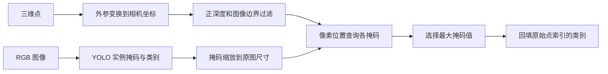

# 点云投影与分割算法

点云处理提供两条不同的标签生成路线：利用二维模型把语义类别投影到三维点，以及根据空间几何分离平面与聚类区域。前者依赖图像、相机参数和分割模型，后者只依赖点的位置。

这些算法位于工具模块与离线脚本中，当前主窗口不会在相机刷新时自动执行它们。

## 实现入口

| 文件 | 核心算法 |
| --- | --- |
| [segmentation_utils.py](../app/utils/camera/segmentation_utils.py) | 二维掩码映射、颜色映射、Open3D 与 Torch 数据转换 |
| [cluster_seg_utils.py](../pipeline_utils/cluster_seg_utils.py) | 深度过滤、两次 RANSAC、DBSCAN、VTK 标签显示 |
| [cluster_seg_pcd.py](../pipeline_utils/cluster_seg_pcd.py) | 按记录并行执行几何分割与 PLY 输出 |
| [seg_from _2d_or_map_color.py](<../pipeline_utils/seg_from _2d_or_map_color.py>) | 图像语义映射脚本与可选 RGBD 点云重建 |

## 点数据格式

PLY 读取函数按属性名提取七列：

```text
[x, y, z, red, green, blue, segment_id]
```

位置是投影与几何处理的输入；颜色用于原图显示或重映射；`segment_id` 的含义由生成算法决定。

Open3D 的传统点云和张量点云在语义映射函数中会转换为 Torch 点坐标，张量接口使用 DLPack 接入，随后按计算设备和数据类型转换。几何聚类使用 NumPy、Open3D 和 scikit-learn。

PLY 本身没有在该实现中统一记录长度单位或颜色范围。几何参数按以米为单位的数据设置；Open3D 重建的颜色通常为 `[0, 1]`，图像映射输出颜色为 `[0, 255]`，历史 PLY 的读取不会自动归一化。下游必须保持同一数据批次的约定一致。

## 二维语义向三维的映射

### 处理流程



`segment_pcd_from_2d()` 在一个函数中完成推理与映射。拆分版本由 `segment_image_with_yolo()` 生成结果，再交给 `label_point_cloud_from_segmentation()`。

`batch_segment_and_label()` 依次遍历点云、图像、内参和外参列表。它是顺序批量包装，没有把多帧合成一次模型推理。四个列表通过 `zip()` 配对，长度不同会在最短列表处停止。

### 外参与投影方向

给定点云坐标系中的齐次点 `P_cloud`，代码先计算：

```text
P_cam = T_cam_cloud · P_cloud
u = round(fx · X_cam / Z_cam + cx)
v = round(fy · Y_cam / Z_cam + cy)
```

所以函数参数 `extrinsic` 必须把点云坐标转换到图像相机坐标；默认单位矩阵要求点云已经处于该相机坐标系。内参使用标准矩阵排列：

```text
K = [ fx   0  cx ]
    [  0  fy  cy ]
    [  0   0   1 ]
```

点先按 `Z_cam > 0` 过滤，再按 `0 <= u < W`、`0 <= v < H` 过滤。代码始终携带原始点索引，最后把标签写回长度为 N 的结果，而不是只返回可见点标签。

这些函数使用无畸变针孔投影，没有使用标定文件中的 `dist_coeffs`。因此输入图像与点云需要具有适配的几何关系；仅提供焦距和主点不会自动校正畸变。图像旋转、裁剪或缩放后也必须对应地调整几何参数。投影方向与[OpenCV 的相机模型定义](https://docs.opencv.org/4.x/d5/d1f/calib3d_solvePnP.html)一致。

### 掩码归属

模型输出 M 个实例掩码及相应类别。实现使用双线性插值将掩码缩放到原图 `(H, W)`，然后对每个有效点查询该像素处的 M 个值：

```text
m* = argmax_m mask_m(v, u)
如果 mask_m*(v, u) > 0.5：label = class_id[m*]
否则：label = -1
```

这里比较的是掩码像素值，不是检测框置信度，也不是三维几何相似度。多个实例属于同一类别时，最终输出相同标签，因此结果是语义类别而非稳定实例编号。

正常结果中，不在任何掩码内、深度非正或超出图像边界的点为 `-1`。单函数版本在没有掩码或访问掩码失败时返回全零；批量包装在标签计算异常时也返回全零。这与正常“无标签”的 `-1` 不一致，还会与真实类别 0 混淆。

批量包装只捕获标签映射阶段的异常，前面的图像读取与模型推理异常仍会向外传播。

## 投影的可见性与成本

当前实现没有深度缓冲或遮挡判断。若前后两个三维点投影到同一个像素，它们会读取同一掩码，后方被遮挡点也可能获得前方物体的类别。

掩码缩放只指定目标尺寸，没有独立恢复模型预处理中的裁剪或填充映射。能否准确对应原图，取决于传入结果的掩码坐标定义。不同设备来源的掩码、类别、点坐标和外参也没有经过统一的设备一致性检查。

主要临时数组包括：

| 数据 | 规模 |
| --- | --- |
| 齐次点与投影坐标 | 与 N 成正比 |
| 原图尺寸掩码 | `M × H × W` |
| 每个掩码对有效点的查询矩阵 | `M × N_valid` |

点数或实例数很大时，掩码查询矩阵可能成为主要显存开销。当前实现没有按点分块；所谓批量处理也会在脚本层累积多帧数据，需与[离线数据工具](offline-dataset-pipeline.md)的内存组织一起理解。

## 颜色映射

`map_point_cloud_colors_from_image()` 使用相同外参与针孔投影，从图像 `(v, u)` 获取 RGB。字符串路径通过 OpenCV 读取并转成 RGB，数组输入则按已经具有正确通道顺序处理。

输出保留原始点坐标，颜色缓冲初始为黑色，只给有效投影位置赋色。超出图像或相机背后的点因此保持黑色，而不是保留旧颜色。代码也没有遮挡判断。

当前实现把 `segment_ids` 按正深度筛选，却保留所有原始点与颜色行。只要存在被深度筛掉的点，最终拼接的行数就不一致，会导致错误。完整七列输出要求位置、颜色与标签使用相同的索引集合。

## 无模型的几何分割

`seg_numpy_pcd()` 接受 `N×7` 数组，首先只保留 `z < 1.5` 的点，再执行几何分割。这个过滤条件没有同时要求 `z > 0`，也不会变换坐标系；阈值的含义取决于输入 Z 轴定义。

### 两次平面提取

`label_point_cloud()` 初始化所有标签为 `-1`，然后：

1. 对全部输入点执行一次 RANSAC 平面分割，将内点标记为 0。
2. 对第一轮外点再次执行平面分割，将内点标记为 1。
3. 将仍未标记的点交给 DBSCAN。

默认 RANSAC 参数为距离阈值 0.01、每次采样 3 点、最多 1000 次迭代。第二次平面提取只检查外点数量大于零，没有检查是否足够支撑三点采样。

第二轮返回的内点索引相对于第一轮外点数组。实现通过第一轮外点的原始索引表映射回完整数组：

```text
outlier_indices_1 = 原始索引 - 第一平面内点索引
second_plane_indices = outlier_indices_1[第二轮局部内点索引]
```

这种索引回映射保证平面标签落在正确的原始行上。平面 0 和平面 1 仅表示算法提取顺序，没有法向方向或语义约束，不能直接理解为“桌面”和“墙面”。

### 剩余区域聚类

剩余点按三维坐标执行 DBSCAN，默认邻域半径 `eps=0.025`、最少样本数 `min_samples=100`。这一步以空间密度和连通关系划分区域，不使用颜色或模型类别。

DBSCAN 原始噪声编号为 `-1`，实现却把所有唯一编号一起从 2 开始重新编号，包括 `-1`。如果噪声存在，噪声也会成为一个普通正整数标签。可视化中“`-1` 为灰色”的逻辑不能再表示这一阶段的所有噪声。

几何输出标签的实际含义为：

| 标签 | 含义 |
| --- | --- |
| 0 | 第一轮 RANSAC 平面 |
| 1 | 第二轮 RANSAC 平面 |
| 2 及以上 | 重新编号后的 DBSCAN 结果，可能包含原噪声集合 |

`remove_small_clusters()` 存在于工具文件中，但 `seg_numpy_pcd()` 的调用被注释掉，批量脚本默认不会执行这一步。独立 `main()` 则会按 100 点阈值过滤，包括平面标签在内的所有标签集合。

## 语义分割与几何分割不能共享标签解释

两条路线都将结果写入 `segment_id`，但编号体系完全不同：YOLO 输出训练集类别编号，几何流程输出每帧重新建立的平面和区域编号。几何标签在不同帧之间不具备稳定身份，也不对应模型的类别表。

语义映射正常保留 N 个点并回填标签；`seg_numpy_pcd()` 返回深度过滤后的较短数组，没有把过滤掩码返回给上层。替换算法后，不能继续假设点数、点索引和标签含义不变。

## 接入条件

算法之间交换数据时，需要共同明确以下条件：

- 点云坐标系、长度单位和外参方向一致。
- 图像通道顺序、分辨率、旋转与内参对应。
- PLY 的颜色数值范围与渲染器约定一致。
- `segment_id` 明确属于语义类别、几何区域还是无标签状态。
- 经过过滤的点集使用相同索引处理位置、颜色与标签。

这些是投影与分割正确性的输入条件，不能通过修改显示颜色或捕获异常后返回零标签来补偿。
