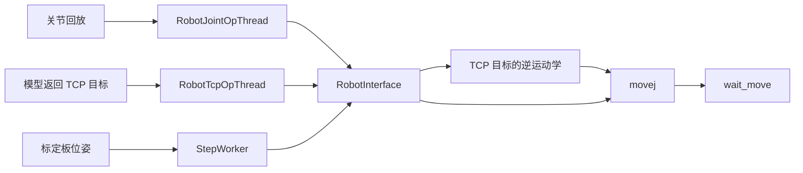
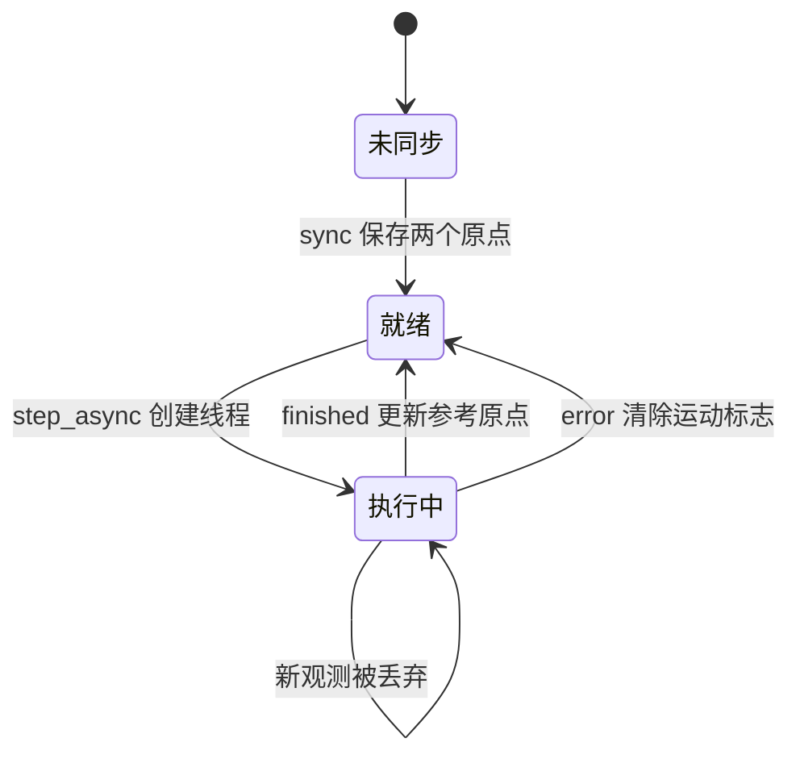

# 机械臂控制与标定板跟随

机器人模块将上层六维目标或关节配置转换为 Lebai SDK 调用，并通过工作线程执行阻塞动作。标定板跟随在此基础上，把一次视觉同步之后的板运动映射成机械臂末端的相对运动。

该模块提供离散目标执行和相对位姿映射，不包含完整的轨迹优化或连续视觉伺服控制器。

## 控制路径



| 文件 | 核心接口 |
| --- | --- |
| [robot_utils.py](../app/utils/robot/robot_utils.py) | `RobotInterface`、`SimLebai` |
| [board_sync.py](../app/utils/robot/board_sync.py) | `BoardRobotSyncManager`、`StepWorker` |
| [op_thread.py](../app/threads/op_thread.py) | `RobotTcpOpThread`、`RobotJointOpThread` |
| [general_callbacks.py](../app/callbacks/general_callbacks.py) | 设备初始化、示教模式、同步原点 |
| [entry.py](../app/entry.py) | 视觉位姿更新与跟随请求 |

## SDK 适配与状态表示

`RobotInterface.find_device()` 初始化 SDK；未指定地址时，取设备发现列表的第一个 IP 并连接。`connect()` 再次建立 SDK 连接并调用 `start_sys()`。GUI 初始化回调固定构造 `RobotInterface(sim=False)`，并在连接流程之后创建跟随管理器。

状态读取通过 `get_kin_data()` 获取：

| 上层类型 | SDK 数据 | 上层表示 |
| --- | --- | --- |
| `joint` | `actual_joint_pose` | 六个关节角 |
| `tcp` | `actual_tcp_pose` | 按 `x, y, z, rx, ry, rz` 提取的 NumPy 数组 |

控制链按米和弧度使用 TCP 数据。历史位姿文本读取函数先把前三项除以 1000、后三项转换为弧度。单位转换辅助函数会原地修改传入数组，不能将转换前后的数组引用当作两份独立数据。

`get_state('tcp')` 和 `get_state('joint')` 分别触发 SDK 查询，没有把两个状态冻结在同一采样时刻。运动期间读取到的 TCP 与关节值可能具有时间差。

## 目标执行

### 关节目标

`step(action, action_type='joint')` 检查输入形状为 `(6,)`，然后调用 `_set_joint_position()`：

```text
movej(joints, acceleration, velocity, time_running, radius)
如果 wait=True：wait_move()
读取并返回关节状态
```

### TCP 目标

`step(..., action_type='tcp')` 先把六维数组转换为 SDK 字典，通过 `kinematics_inverse()` 求关节位置，再进入同一个 `movej` 路径。

TCP 目标由逆运动学转换成关节运动，并没有在仓库代码中生成末端笛卡尔直线路径。每个目标之间的实际运动由 SDK 决定。

默认运动参数为加速度 2、速度 2、运行时间 0、圆角半径 0。`high_speed_mode()` 改为 `10, 10, 0, 0`，`low_speed_mode()` 恢复为 `2, 2, 0, 0`。这些数值直接交给 SDK，没有经过上层物理单位或限幅转换。

### 异常与执行反馈

`connect()`、`_set_joint_position()` 和 `_set_tcp_position()` 捕获异常后主要记录日志，没有向上层返回统一的成功状态。因此，线程发出“已处理该目标”的进度信号，不等于机械臂实际到达了目标。

`RobotTcpOpThread` 在序列开始时退出示教模式，逐个阻塞执行 TCP 目标，最后重新进入示教模式。`RobotJointOpThread` 对关节目标执行类似流程，并额外提供录制开始与结束信号。两者没有统一取消协议或全局动作队列。

## 标定板相对运动映射

### 同步原点

`sync(board_pose, robot_pose)` 保存两个参考位姿：

- `B0 = T_cam_board(0)`：同步时标定板相对相机的位姿。
- `R0 = T_base_tool(0)`：同步时工具相对机器人基座的位姿。

当前板位姿为 `B1` 时，工作线程使用局部增量：

```text
D_board = inverse(B0) · B1
T_target = R0 · D_robot
```

没有轴交换时，`D_robot = D_board`。这样把同步板坐标中的相对变化复制到同步工具坐标中，避免每次都要求一个绝对目标位置。

这套关系假定两边局部增量可以按选定映射解释，不会估计 `T_base_cam`。它不能作为相机到机器人基座外参的替代结果。

### 当前轴交换

主入口调用 `step_async(..., use_swap=True)`。工作线程把平移和旋转向量都按以下规则重排：

```text
[x, y, z]    → [z, y, x]
[rx, ry, rz] → [rz, ry, rx]    这里后三项是旋转向量
```

该映射是直接分量置换。交换 X 与 Z 的矩阵行列式为 `-1`，不属于纯旋转；对旋转向量做同样置换，也不能直接等同于一般刚体坐标变换。它表达了当前交互所用的轴映射规则，没有形成经过标定的三维坐标关系。

板位姿在进入本模块前还受到 `SceneStreamer.board_detect()` 中数组拼接顺序的影响，详见[相机标定与标定板定位](calibration.md)。

## 异步跟随状态



`step_async()` 在 `is_moving=True` 时直接返回，不排队缓存新目标。这样不会因为相机更新快于机械臂而积累旧动作，但执行期间的运动也不会逐个重放。

每次接受请求时，管理器新建一个 `QThread` 与 `StepWorker`，将 worker 移入线程，再通过 `started` 信号执行计算与阻塞式机器人移动。管理器保存线程和 worker 的引用，保证本次任务执行期间对象仍存在。

成功结束后，`on_step_finished()` 将 `is_moving` 清零，并从主窗口当前的 `board_and_robot_pose_list` 读取新的参考原点。它没有使用发送目标时的 `_last_board_pose` 与刚计算的目标位姿作为新原点。

这一原点更新方式意味着：后续增量从运动结束附近的最新可用观测继续计算，执行期间的板运动可能被吸收到新原点中，而不是作为下一条待补执行的运动。两项参考位姿也没有硬件时间同步。

错误路径只清除运动标志并输出错误，没有像成功路径一样连接线程退出与 worker 清理。线程的对象生命周期与业务状态在异常情况下并不完整一致。

## 跟随触发与观测丢失

主窗口仅在启用 Track Board 且本轮存在 `board_pose` 时请求跟随。板检测依赖初始化过的标定模型、有效内参、检测开关及符合名称约定的相机图像。

同步按钮读取最近保存的板与机器人位姿对。该列表只在一轮同时具有两种位姿时更新，没有过期时间。检测丢失不会主动取消已经下发的机器人动作，也不会清除之前保存的同步观测。

尚未同步就请求跟随时，`step_async()` 会抛出异常；主刷新路径没有统一的跟随前置状态检查。设备连接、有效观测和原点同步因此是不同的状态条件。

## 回放与采样握手

`RobotJointOpThread` 首先移动到第一个目标点。该移动结束后，它发出 `action_start`，然后等待 `robot.recording_flag` 为真。录制回调响应信号，设置标志并启动采样线程，工作线程才继续执行后续目标。

最后一个目标结束后，工作线程额外等待 0.5 秒，发出 `action_finished`，并恢复示教模式。采样停止与低速参数恢复由录制结束回调处理。

这两个信号通过 lambda 连接到普通函数，未显式声明接收对象的队列槽。上述顺序描述业务握手，不代表回调内的控件操作已经具备主线程保证；相关线程约束见[系统架构](architecture.md)。

因此，第一段“前往起始点”的移动不在正常录制区间内，末端停止后仍可能记录一小段静止状态。完整时序见[示教数据采集与持久化](demonstration-data.md)。

## 仿真实现的边界

`SimLebai` 提供与部分 SDK 方法同名的接口，但每次 `get_kin_data()` 都重新随机生成 TCP 和关节状态，逆运动学也返回随机关节值。它不是根据命令演化的运动学仿真，不能用来判断轨迹误差或收敛性。

其 `wait_move()` 引用了 `time.sleep()`，而模块只在脚本入口中导入 `time`。作为普通模块使用该仿真实现时，此方法存在缺失导入。GUI 的机器人初始化也未暴露选择仿真的分支。

## 控制系统边界

跟随、Agent 动作和关节回放共享同一个机器人对象，只有跟随模块自身具有运行标志。当前代码没有统一仲裁这三类动作，也没有在下发前执行碰撞、工作空间或姿态跳变检查。

采集模型中对关节角进行的范围检查发生在“保存数据”环节，并不约束动作执行。阻塞等待结束、进度信号发出和目标实际达成也不是同一个保证。需要判定动作结果时，应使用与目标对应的机器人反馈，而不是复用界面进度。
